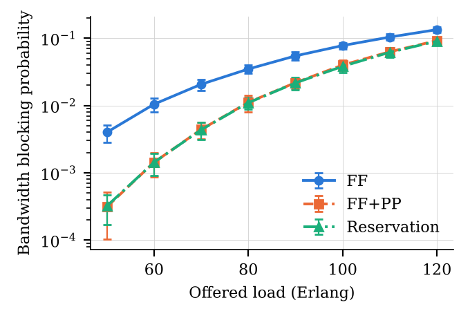
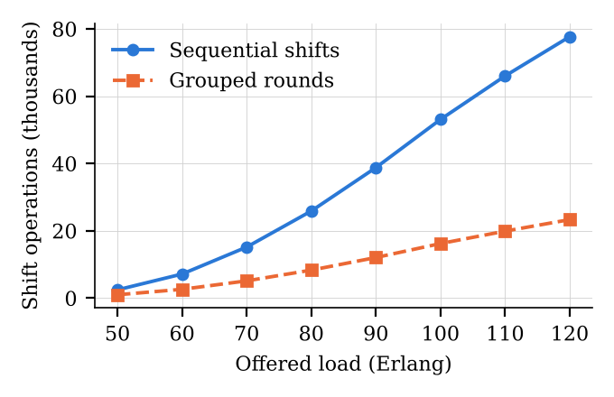
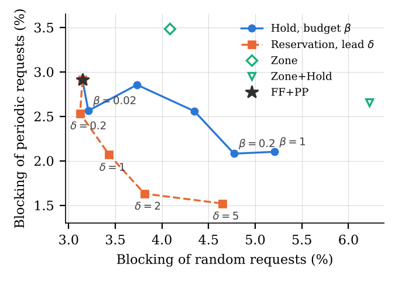
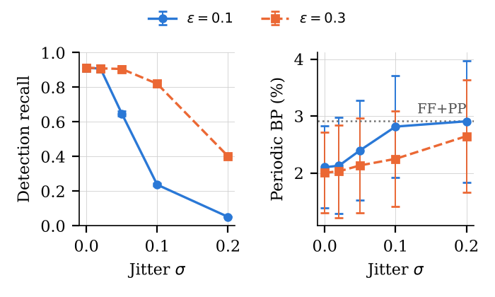

# Pattern-Aware Spectrum Management in Elastic Optical Networks

Simulation code, experiments and results behind the conference paper
*"Pattern-Aware Spectrum Reservation and Grouped Push-Pull Defragmentation in Elastic Optical Networks"*
(M. M. Malayeri, M. Nickray — draft). It continues my MSc thesis at the University of Qom
(*Optimization of Fragmented Spectrum in Elastic Optical Networks Using Pattern Recognition*, 2022).

The commit history follows the research process step by step (`git log`).

## Why a new simulator

The thesis evaluated the method in OPNET. Re-checking the OPNET output (`data/cons22.txt`, ~100,000 requests) showed two problems:

1. **Offered load ≈ 5,000 Erlang** (≈250 requests per time unit × mean holding time 20), far above what NSFNET can carry, so almost every scheme blocks heavily.
2. **No periodic requests in the trace.** The OPNET generator writes its periodic requests to a different file (`cons3.txt`), so the pattern-recognition step had nothing to detect — the most likely reason for the very small gain reported in the thesis.

This repository regenerates **the same traffic model** (Poisson arrivals, uniform node pairs, 5–20 FS per request, exponential holding time with mean 20) at realistic loads, **plus periodic flows** whose share of the load is controlled, and evaluates the schemes in a Python discrete-event simulator.

## Model

| Item | Value |
|---|---|
| Topology | NSFNET, 14 nodes, 21 links, real link lengths (300–2800 km) |
| Spectrum | 320 FS per link, 1 FS guard band |
| Routing / spectrum assignment | 3 shortest paths (Yen), First-Fit |
| Traffic | Poisson arrivals, uniform node pairs, 5–20 FS, exp. holding time (mean 20) |
| Periodic flows | 20 flows, fixed node pair and FS demand, constant period; 30% of load unless stated |
| Detection | 4 consecutive arrivals of the same (s, d, FS) with equal intervals (±0.1) |
| Runs | 20,000 requests after 2,000 warm-up, 10 seeds per point, 95% confidence intervals |

## Schemes

| Scheme | What it does |
|---|---|
| `FF` | First-Fit, no defragmentation |
| `FF+PP` | FF + reactive Push-Pull defragmentation when a request is blocked |
| `Proposed` (reservation) | FF+PP + periodic-flow detection + spectrum reserved just before each expected arrival |
| `Prop-Zone` | reservation + detected periodic flows use Last-Fit (top of the band), Push-Pull pushes them up |
| `Prop-Hold` | reservation + a periodic flow keeps its spectrum between repeats |
| `Prop-Zone+Hold` | both |

Route grouping: the routes moved by Push-Pull are grouped with a greedy maximal-independent-set algorithm, so routes that share no link are shifted in parallel.

## Main results (10 seeds)

 

- **Push-Pull** lowers bandwidth blocking by **31–92%** compared with FF over 50–120 Erlang.
- **Route grouping** cuts the number of sequential shift operations by **2.5–3.3×**.
- **Detection** is accurate: precision **1.00** for reservations, recall **0.86–0.92**.
- **Reservation alone** changes total blocking by −4% to +3% vs FF+PP — **not statistically significant**.
- **Hold** lowers blocking of periodic flows by **25–36% at 80–120 Erlang**, but raises blocking of the other traffic (+41% to +85%), so total blocking rises.
- **Zone** cuts Push-Pull moves by **27–60%**, but raises total blocking (+14% to +147%).
- **Decision tree** (per-pair demand above threshold in the next window): chance level on the OPNET trace (precision 0.54 = base rate 0.54); precision 0.91–0.97 when 30–50% of the load is periodic.

### Tuning the trade-off (Step 7, 100 Erlang, paired 95% CIs over the same seeds)

 

- **Reservation lead time** is the best knob: with lead δ = 1–2 (≈ 7–15% of the period) periodic blocking falls by **29–44%** with **no significant change in total blocking**; δ = 5 raises total blocking by 21%.
- **Hold with a budget β** (max share of a link's slots idle in held blocks): β = 0.02 lowers periodic blocking by 9–12% at no significant total cost; larger β moves toward unrestricted Hold.
- **Timing jitter**: with ε = 0.1, recall falls to 0.24 at σ = 0.1 and the benefit disappears; ε = 0.3 keeps recall at 0.82. Rule of thumb: ε ≈ 3σ.

In short: recognizing traffic patterns does not create free capacity here; it decides *who* gets the spectrum. That is useful for protecting scheduled services (e.g., IPTV), at a cost to other traffic.

## Files

```text
eonsim.py                              simulator (all schemes)
data/cons22.txt                        OPNET traffic trace from the thesis
experiments/01_calibrate_load.py       find the useful load range
experiments/02_quick_test_proposed.py  first test of reservation
experiments/03_run_experiments_v1.py   first full run (FF, FF+PP, Proposed)
experiments/04_decision_tree.py        decision-tree demand prediction
experiments/05_test_zone_hold_variants.py  quick test of zone / hold variants
experiments/06_run_final.py            final runs, all schemes, 10 seeds
experiments/07_plots_and_tables.py     figures and summary tables
experiments/08_sensitivity_and_hold_budget.py  jitter, lead time and Hold budget runs
experiments/09_plots_sensitivity.py    trade-off and jitter figures
paper/                                 LaTeX source and PDF of the conference paper
results/                               raw results (JSON) and summaries
figures/                               figures used in the paper
```

## Run

```bash
pip install numpy matplotlib scikit-learn
python experiments/06_run_final.py        # ~30 min on 2 cores
python experiments/07_plots_and_tables.py
python experiments/08_sensitivity_and_hold_budget.py   # ~35 min on 2 cores
python experiments/09_plots_sensitivity.py
```

Every run calls `EONSim.check()`, which verifies that the spectrum map matches the active connections and that no lightpaths overlap.

## Related repositories

- [NSFNET Topology Simulator for EONs (OPNET)](https://github.com/malayerimahdi/NSFNET-Network-Topology-Simulator-on-Opnet-For-Elastic-Optical-Network-EON-)
- [EON Simulator: Real-time Packet Pattern Finder](https://github.com/malayerimahdi/EON-Simulator-Real-time-Packet-Pattern-Finder-)
- [AI-Based Dynamic Resource Allocation](https://github.com/malayerimahdi/AI-Based-Dynamic-Resource-Allocation-for-Reducing-Blocking-Probability)

**Author:** Mohammad Mahdi Malayeri · [malayerimahdi.github.io](https://malayerimahdi.github.io)
